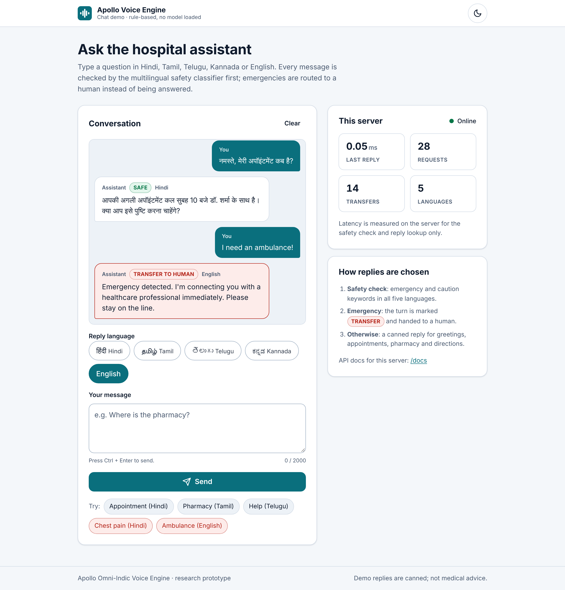
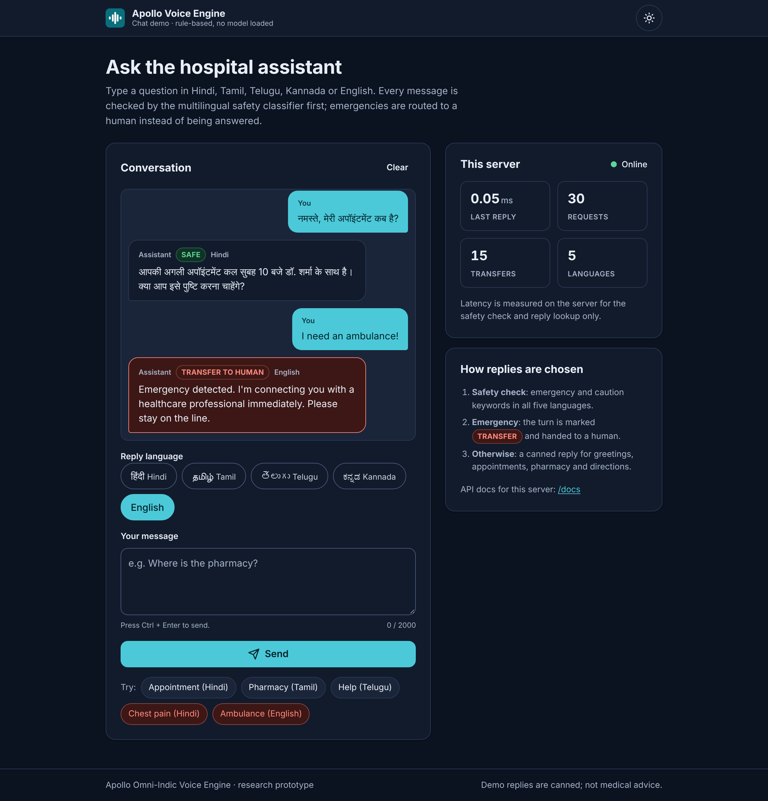
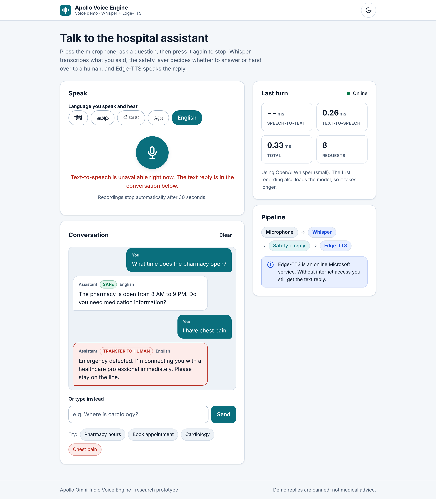
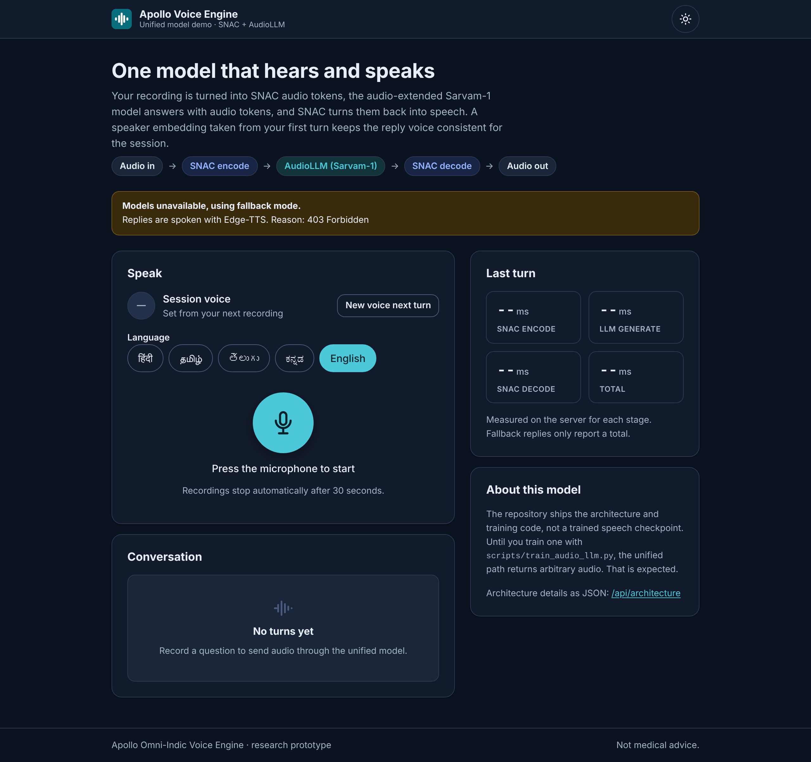
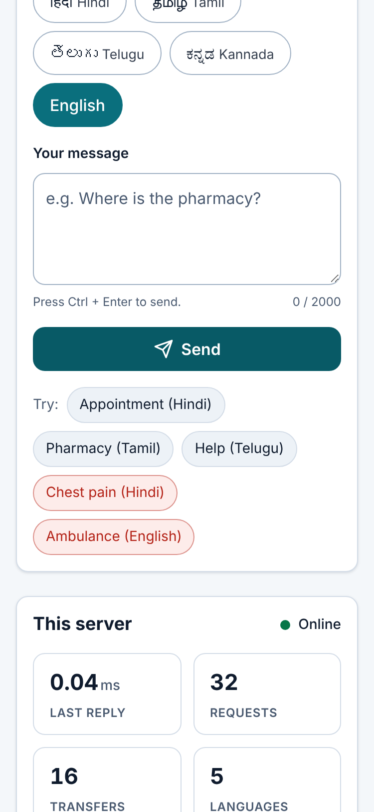
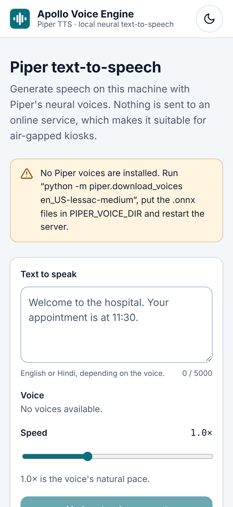
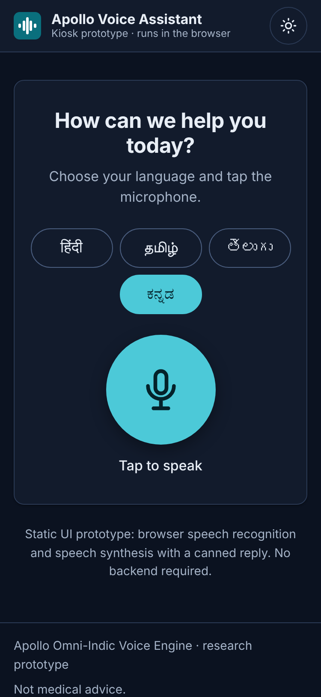
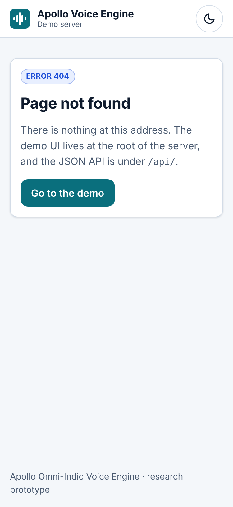
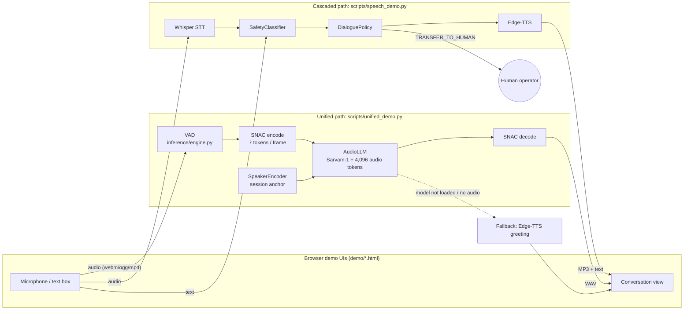
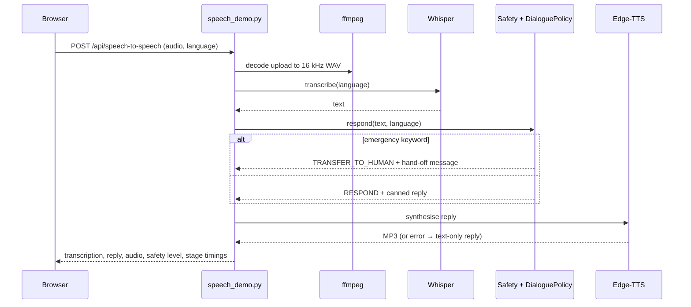

# Apollo Omni-Indic Voice Engine

**A speech-to-speech voice assistant for Indian languages, built around one transformer that both hears and speaks.**


Hospital front desks and patient helplines in India get calls in Hindi, Tamil, Telugu, Kannada and English, often from people who can't type or read comfortably. This project is a research prototype of a voice assistant for that setting. A caller speaks; the assistant answers out loud in the same language. Anything that sounds like an emergency is handed to a human instead of being answered.

It is aimed at **ML engineers and researchers** working on Indic speech, and at **developers** who want working, tested building blocks (audio tokenisation, vocabulary extension, VAD, safety routing, demo servers) to build a kiosk or call-centre assistant on.

> [!IMPORTANT]
> **Project status: research prototype.** All of the plumbing is implemented and covered by an offline test suite: SNAC tokenisation, vocabulary extension, speaker conditioning, the training loop, VAD, the safety classifier and five browser demos. **A trained speech checkpoint is not part of this repository.** Until you train one with `scripts/train_audio_llm.py`, the unified model produces arbitrary audio. The demo servers use rule-based replies, Whisper and Edge-TTS so they stay usable in the meantime.

---

## Contents

- [Screenshots](#screenshots)
- [Key features](#key-features)
- [The demos at a glance](#the-demos-at-a-glance)
- [Tech stack](#tech-stack)
- [Architecture](#architecture)
- [Project structure](#project-structure)
- [Getting started](#getting-started)
- [Configuration](#configuration)
- [Running the demos](#running-the-demos)
- [Usage examples](#usage-examples)
- [Scripts and commands](#scripts-and-commands)
- [API reference](#api-reference)
- [Training](#training)
- [Testing and code quality](#testing-and-code-quality)
- [Deployment](#deployment)
- [Troubleshooting and FAQ](#troubleshooting-and-faq)
- [Known limitations](#known-limitations)
- [Roadmap](#roadmap)
- [Contributing](#contributing)
- [License](#license)
- [Acknowledgements](#acknowledgements)

---

## Screenshots

All screenshots were captured from the demo servers running locally, without model downloads or internet access. The unified and Piper demos therefore show their "not available" states, and the voice demo shows its text-only reply when Edge-TTS can't be reached. Every page has light and dark themes, follows the OS setting by default and has a toggle in the header.

| Chat demo, light (`scripts/api_demo.py`) | Chat demo, dark |
|---|---|
|  |  |

| Voice demo (`scripts/speech_demo.py`) | Unified model demo (`scripts/unified_demo.py`) |
|---|---|
|  |  |

| Phone (375 px) | Piper TTS (`scripts/piper_tts_server.py`) | Kiosk prototype (`demo/index.html`) | 404 page |
|---|---|---|---|
|  |  |  |  |

---

## Key features

**Unified speech model** (`apollo_voice_engine/models/audio_llm.py`)
- Extends [Sarvam-1](https://huggingface.co/sarvamai/sarvam-1), a 2B Indic LLM, with `<|audio_start|>`, `<|audio_end|>` and 4,096 SNAC audio tokens. Audio ids are placed *after* the full text vocabulary, so audio and text never collide.
- A speaker-embedding prefix (the "session anchor") keeps the reply voice consistent across a conversation.
- Saved checkpoints reload without extending the vocabulary twice. 8-bit and 4-bit loading with bitsandbytes on CUDA.

**Audio tokeniser** (`models/snac_wrapper.py`)
- Wraps the 24 kHz [SNAC](https://github.com/hubertsiuzdak/snac) codec: 3 codebooks in a 1:2:4 ratio, interleaved into 7 tokens per ~85 ms frame.
- Accepts `(T,)`, `(B, T)` or `(B, 1, T)` audio and round-trips encode → decode.

**Training** (`training.py`, `scripts/train_audio_llm.py`)
- Three phases on IndicVoices-style data: `understanding` (audio → text), `generation` (text → audio) and `end2end` (audio → audio), all with a masked causal-LM loss.

**Real-time helpers** (`inference/engine.py`)
- WebRTC VAD that works at any sample rate (it resamples and frames internally) and fires end-of-utterance once per utterance.
- A streaming inference engine that records latency metrics.

**Safety first** (`safety/classifier.py`, `dialogue.py`)
- Emergency and caution keywords in all five languages. English keywords match on word boundaries, so "icu" doesn't match "ridiculous".
- Emergencies return `TRANSFER_TO_HUMAN` instead of an answer. Model replies containing prescriptions, doses or diagnoses are flagged.

**Cascaded baseline** (`speech_pipeline.py`): Whisper → Sarvam-1 → MMS-TTS (VITS), for comparison with the unified model.

**Five browser demos** sharing one design system (`demo/assets/`)
- Light and dark themes, responsive from 375 px phones to desktops, keyboard-navigable, WCAG AA colour contrast.
- Loading, empty, error and success states throughout, plus a 404 page.
- No external fonts or CDNs, so they work offline on a kiosk.

---

## The demos at a glance

| Demo | Start with | Default URL | What you can do | Needs |
|---|---|---|---|---|
| **Chat** | `python scripts/api_demo.py` | http://127.0.0.1:8000 | Type questions in 5 languages, see safety routing and emergency hand-off | Nothing beyond the `server` extra. Starts instantly. |
| **Voice** | `python scripts/speech_demo.py` | http://127.0.0.1:8000 | Speak or type; Whisper transcribes, Edge-TTS answers out loud | `speech` extra, `ffmpeg`, internet for Edge-TTS |
| **Unified model** | `python scripts/unified_demo.py` | http://127.0.0.1:6969 | Send audio through SNAC → AudioLLM → SNAC with a session voice | Sarvam-1 (~5 GB) and SNAC weights; GPU recommended |
| **Piper TTS** | `python scripts/piper_tts_server.py` | http://127.0.0.1:8085 | Offline neural text-to-speech, play or download WAV | `piper-tts` + downloaded voices |
| **Kiosk prototype** | open `demo/index.html` | file / any static server | Browser-only speech recognition and synthesis with a canned reply | Chrome or Edge (Web Speech API) |
| **Kiosk API** | `apollo_voice_engine.integration.create_fastapi_app()` | your choice | Session and WebSocket audio signalling for a kiosk | `server` extra |

---

## Tech stack

| Layer | Technology | Used for |
|---|---|---|
| Language | Python 3.10+ | Everything server-side |
| Deep learning | PyTorch 2.1+, Hugging Face Transformers 4.56+, Accelerate | AudioLLM, generation, `device_map` loading |
| Audio codec | [SNAC](https://github.com/hubertsiuzdak/snac) 24 kHz | Audio ⇄ discrete tokens |
| Base LLM | [Sarvam-1](https://huggingface.co/sarvamai/sarvam-1) (2B, Indic) | Backbone of the unified model |
| Speech activity | `webrtcvad-wheels` | Voice activity / end-of-utterance detection |
| Speech-to-text | [OpenAI Whisper](https://github.com/openai/whisper) | Voice demo, cascaded pipeline |
| Text-to-speech | [Edge-TTS](https://github.com/rany2/edge-tts), [Piper](https://github.com/OHF-Voice/piper1-gpl), MMS-TTS | Voice replies (online / offline) |
| Web | FastAPI, Uvicorn, standard-library `http.server` | Demo servers and APIs |
| Front end | Plain HTML, CSS and JavaScript (no build step) | Demo UIs, shared design system |
| Quantisation | bitsandbytes (optional) | 8-/4-bit loading on CUDA |
| Quality | pytest, Ruff, Playwright (manual UI checks) | Tests, lint and format |

---

## Architecture

### System overview



### What happens on one voice turn (voice demo)



### Token layout

After `AudioLLM.load_model()`:

```
[0, audio_offset)                    text tokens + <|audio_start|> + <|audio_end|>
[audio_offset, audio_offset + 4096)  SNAC codes 0..4095
```

`audio_offset` is computed at load time from the tokenizer and embedding sizes, so it adapts to the base model. `SNACWrapper` also emits codes with a legacy `+50000` offset for standalone use; `AudioLLM.audio_tokens_to_ids` accepts either form.

SNAC frames are flattened coarse-to-fine: for each ~85 ms frame, 1 code from codebook 0, 2 from codebook 1 and 4 from codebook 2 (7 tokens).

### Training prompt formats

Defined in `apollo_voice_engine/training.py`. Masked positions are not supervised.

| Phase | Input (masked) | Target |
|---|---|---|
| `understanding` | `Transcribe … in {lang}:` `<as>` audio `<ae>` | text `</s>` |
| `generation` | `Synthesize … in {lang}: {text}` `<as>` | audio `<ae>` |
| `end2end` | `<as>` audio `<ae>` `<as>` | audio `<ae>` (self-reconstruction until paired dialogue audio is available) |

### Front end

The five pages are static HTML served by the Python servers. They share:

- `demo/assets/apollo.css`: the design system. Colour, spacing, type, radius and shadow tokens on `:root`; a dark palette applied through `prefers-color-scheme` or an explicit `data-theme`; components such as buttons, segmented controls, cards, chat bubbles, badges, alerts, stats and the microphone button.
- `demo/assets/apollo-ui.js`: the theme toggle (saved in `localStorage`), accessible single-select groups with arrow-key support, `fetchJson` with friendly error messages, and a `MediaRecorder` wrapper that asks for the microphone only when you press record and stops after 30 s.
- `scripts/web_ui.py`: mounts `/assets`, serves `/favicon.ico` and returns `demo/404.html` to browsers (API clients still get JSON 404s). The Piper server serves the same three asset files from a fixed allow-list.

---

## Project structure

```
Speech-to-Speech/
├── apollo_voice_engine/              # the installable Python package
│   ├── __init__.py                   # __version__, load_config()
│   ├── config/model_config.yaml      # reference model / training / inference settings
│   ├── models/
│   │   ├── audio_llm.py              # Sarvam-1 + audio vocabulary, speaker prefix, generation
│   │   ├── snac_wrapper.py           # SNAC encode/decode, 7-token frame interleaving
│   │   └── speaker_encoder.py        # speaker-embedding interface (deterministic mock for now)
│   ├── inference/engine.py           # VAD, InferenceEngine, StreamingSession
│   ├── safety/classifier.py          # multilingual emergency / caution / unsafe-advice detection
│   ├── integration/webrtc_server.py  # kiosk sessions + FastAPI/WebSocket app factory
│   ├── training.py                   # training-example construction and collation
│   ├── speech_pipeline.py            # cascaded Whisper → LLM → MMS-TTS baseline
│   ├── dialogue.py                   # rule-based multilingual dialogue policy (demo replies)
│   ├── audio_io.py                   # ffmpeg decoding, WAV encoding helpers
│   ├── metrics.py                    # thread-safe running metrics
│   └── settings.py                   # APOLLO_* environment settings (+ optional .env)
├── scripts/
│   ├── api_demo.py                   # chat demo server (FastAPI, no models)
│   ├── speech_demo.py                # voice demo server (Whisper + Edge-TTS)
│   ├── unified_demo.py               # unified SNAC + AudioLLM demo server and engine
│   ├── piper_tts_server.py           # Piper TTS server (standard library only)
│   ├── web_ui.py                     # shared assets, favicon and 404 page for FastAPI servers
│   ├── demo.py                       # CLI: one-shot speech-to-speech on a WAV file
│   ├── unified_cli.py                # CLI: run dataset samples through the unified engine
│   ├── train_audio_llm.py            # three-phase training script
│   └── download_models.py            # pre-fetch Sarvam-1 and SNAC from Hugging Face
├── demo/
│   ├── assets/                       # apollo.css, apollo-ui.js, favicon.svg (shared by all pages)
│   ├── chat_demo.html                # UI for api_demo.py
│   ├── speech_demo.html              # UI for speech_demo.py
│   ├── unified_demo.html             # UI for unified_demo.py
│   ├── piper_demo.html               # UI for piper_tts_server.py
│   ├── index.html                    # static kiosk prototype (no backend)
│   └── 404.html                      # not-found page served by every server
├── docs/screenshots/                 # README screenshots
├── indic_voices_dataset/metadata.json  # 2,000 IndicVoices utterances (audio not committed)
├── notebooks/                        # Colab experiments + architecture_diagram.png
├── tests/                            # offline pytest suite
├── pyproject.toml                    # package metadata, extras, Ruff and pytest config
├── requirements.txt                  # installs the package with all common extras
├── requirements-piper.txt            # piper-tts
└── .env.example                      # every supported environment variable
```

---

## Getting started

### Prerequisites

| Requirement | Why | Check |
|---|---|---|
| Python **3.10+** | Language level used throughout | `python --version` |
| `pip` and `venv` | Installing the package | `python -m pip --version` |
| `ffmpeg` on `PATH` | Decoding microphone uploads in the voice and unified demos | `ffmpeg -version` |
| ~3 GB free disk | PyTorch and its CUDA libraries | |
| ~6 GB more, plus a CUDA GPU (recommended) | Sarvam-1 and SNAC for the unified demo / training | `nvidia-smi` |
| Internet access | First model downloads; Edge-TTS is an online service | |

The chat demo, the Piper demo, the kiosk prototype and the whole test suite run on a plain CPU laptop.

Install `ffmpeg` with `sudo apt install ffmpeg` (Debian/Ubuntu), `brew install ffmpeg` (macOS) or `winget install ffmpeg` (Windows).

### Installation

```bash
# 1. Clone
git clone https://github.com/jeevithg090/Speech-to-Speech.git
cd Speech-to-Speech

# 2. Create and activate a virtual environment
python -m venv .venv
source .venv/bin/activate          # Windows: .venv\Scripts\activate

# 3. Install the package with the extras you need
pip install -e ".[server,dev]"     # core + FastAPI demos + pytest/ruff

# 4. (Optional) more features
pip install -e ".[speech]"         # Whisper + Edge-TTS for the voice demo
pip install -e ".[training]"       # librosa, soundfile, tqdm for training and the CLIs
pip install -e ".[quantization]"   # bitsandbytes, CUDA only
pip install -r requirements-piper.txt   # Piper TTS

# ...or everything except quantisation and Piper in one go
pip install -r requirements.txt

# 5. (Optional) configuration
cp .env.example .env

# 6. Check the install
pytest -q
python scripts/api_demo.py         # then open http://127.0.0.1:8000
```

`torch` comes from PyPI with CUDA libraries on Linux. For a smaller CPU-only install, install PyTorch first from the [official selector](https://pytorch.org/get-started/locally/) (for example `pip install torch --index-url https://download.pytorch.org/whl/cpu`), then run step 3.

**Extras reference**

| Extra | Installs | Needed for |
|---|---|---|
| *(none)* | torch, numpy, transformers, accelerate, huggingface_hub, snac, pyyaml, webrtcvad-wheels | Library use, unified engine |
| `server` | fastapi, uvicorn[standard], python-multipart, python-dotenv | All FastAPI demo servers, `.env` loading |
| `speech` | openai-whisper, edge-tts | `speech_demo.py`, unified fallback voice |
| `training` | librosa, soundfile, tqdm | `train_audio_llm.py`, `demo.py`, `unified_cli.py` |
| `quantization` | bitsandbytes | 8-/4-bit model loading (CUDA) |
| `dev` | pytest, httpx, ruff | Tests, lint, format |

---

## Configuration

All configuration is through environment variables, and every one is optional. Copy `.env.example` to `.env`; it is loaded automatically when `python-dotenv` is installed (it comes with the `server` extra).

| Variable | Required | Default | Used by | Description |
|---|---|---|---|---|
| `APOLLO_HOST` | No | `127.0.0.1` | all servers | Interface to bind. Use `0.0.0.0` to expose the server on your network or inside Docker. |
| `APOLLO_PORT` | No | `8000` (api/speech), `6969` (unified), `8085` (piper) | all servers | Port override. Set a different one per server if you run several at once. |
| `APOLLO_CORS_ORIGINS` | No | `*` | all servers | Comma-separated list of allowed origins. `*` allows any origin; restrict it in production. |
| `APOLLO_MAX_UPLOAD_MB` | No | `10` | voice, unified | Maximum audio upload size in MB. Larger uploads get HTTP 413. |
| `APOLLO_MAX_TEXT_CHARS` | No | `2000` | chat, voice | Maximum length of a text query. Longer queries get HTTP 422. |
| `APOLLO_WHISPER_MODEL` | No | `small` | voice | Whisper size: `tiny`, `base`, `small`, `medium` or `large`. Smaller is faster, larger is more accurate. |
| `HF_TOKEN` | No | – | model downloads | Hugging Face token, only needed for gated or private models. Keep it secret. |
| `PIPER_VOICE_DIR` | No | `~/.local/share/piper_voices` | piper | Folder containing Piper `.onnx` voices and their `.onnx.json` configs. |
| `NGROK_AUTH_TOKEN` | No | – | notebooks | Used by the Colab notebooks to expose a demo through ngrok. Keep it secret. |

Hugging Face's own variables (`HF_HOME`, `HF_HUB_OFFLINE`, …) work as usual. Integer variables that aren't numbers fail at start-up with a clear message, for example `Environment variable APOLLO_PORT must be an integer, got 'abc'`.

Model and training hyper-parameters for reference live in `apollo_voice_engine/config/model_config.yaml` (load with `apollo_voice_engine.load_config()`). The training script takes its settings from command-line flags.

---

## Running the demos

### Development

Each server prints its URL on start-up. Stop with <kbd>Ctrl</kbd>+<kbd>C</kbd>.

```bash
# Chat demo: instant, no models. API docs at /docs
python scripts/api_demo.py                     # http://127.0.0.1:8000

# Voice demo (Whisper + Edge-TTS). Use another port if the chat demo is running
APOLLO_PORT=8001 python scripts/speech_demo.py  # http://127.0.0.1:8001

# Unified model demo. Models load in the background; the page shows progress
python scripts/download_models.py              # optional: pre-fetch ~5 GB
python scripts/unified_demo.py                 # http://127.0.0.1:6969

# Piper TTS (offline)
pip install -r requirements-piper.txt
mkdir -p ~/.local/share/piper_voices && (cd ~/.local/share/piper_voices && \
  python -m piper.download_voices en_US-lessac-medium && \
  python -m piper.download_voices hi_IN-rohan-medium)
python scripts/piper_tts_server.py --open      # http://127.0.0.1:8085

# Static kiosk prototype: open the file, or serve the folder
python -m http.server 8090 --directory demo    # http://127.0.0.1:8090
```

For auto-reload while editing Python code, run the FastAPI apps through Uvicorn directly:

```bash
uvicorn scripts.api_demo:app --reload --port 8000
```

HTML, CSS and JS changes need only a browser refresh: the pages are read from disk on every request.

> [!NOTE]
> Browsers only allow microphone access on `https://` pages or on `localhost` / `127.0.0.1`. If you open a demo from another device on your network, put it behind HTTPS (see [Deployment](#deployment)).

### Production

```bash
APOLLO_HOST=0.0.0.0 APOLLO_CORS_ORIGINS=https://kiosk.example.org \
  uvicorn scripts.api_demo:app --host 0.0.0.0 --port 8000 --workers 2
```

See [Deployment](#deployment) for the details that matter (workers per GPU, offline models, TLS).

---

## Usage examples

### Walkthrough: chat demo

1. Run `python scripts/api_demo.py` and open http://127.0.0.1:8000.
2. Pick a **reply language**. Arrow keys move between languages.
3. Type a question, or click an example chip such as *Appointment (Hindi)*, then press **Send** or <kbd>Ctrl</kbd>+<kbd>Enter</kbd>.
4. The reply appears with a safety badge (`SAFE`, `CAUTION` or `TRANSFER TO HUMAN`). The **This server** panel shows the measured server latency and the request and transfer counters.
5. Try *Chest pain (Hindi)* or *Ambulance (English)*. The turn is marked for hand-off and highlighted in red.

### Walkthrough: voice demo

1. Run the voice demo and open it on `localhost`.
2. Choose the language you will speak, press the microphone (the browser asks for permission the first time) and ask a question. Press again to stop; recordings also stop after 30 s.
3. The transcription and reply appear in the conversation, and the reply is played aloud. Use **Play reply** to hear it again. No microphone? Type in **Or type instead** or click an example.
4. If Edge-TTS can't be reached, you still get the text reply and a clear message.

### Walkthrough: unified model demo

1. Run `python scripts/unified_demo.py`. The banner shows **Loading models…**, then either **Models loaded** or **Models unavailable, using fallback mode** with the reason.
2. Record a question. The first turn sets the **session voice** (shown as a coloured badge with an id); later turns keep it. Press **New voice next turn** to reset it.
3. The stats panel shows SNAC encode, LLM generate, SNAC decode and total time for the turn.

### API calls

Chat (safe):

```bash
curl -s -X POST http://127.0.0.1:8000/api/chat \
  -H 'Content-Type: application/json' \
  -d '{"text": "Where is the pharmacy?", "language": "en"}'
```

```json
{"response": "The pharmacy is open from 8 AM to 9 PM. Do you need medication information?",
 "action": "RESPOND", "language": "en", "safety_level": "safe", "latency_ms": 0.074}
```

Chat (emergency, Hindi):

```bash
curl -s -X POST http://127.0.0.1:8000/api/chat \
  -H 'Content-Type: application/json' \
  -d '{"text": "मुझे छाती में दर्द हो रहा है", "language": "hi"}'
```

```json
{"response": "आपातकाल का पता चला। मैं आपको तुरंत एक स्वास्थ्य विशेषज्ञ से जोड़ रहा हूं। कृपया लाइन पर रहें।",
 "action": "TRANSFER_TO_HUMAN", "language": "hi", "safety_level": "emergency", "latency_ms": 0.056}
```

Safety classification only:

```bash
curl -s -X POST http://127.0.0.1:8000/api/classify \
  -H 'Content-Type: application/json' -d '{"text": "I have a mild fever"}'
```

```json
{"level": "caution", "keywords": ["fever"], "should_transfer": false,
 "message": "Medical concern detected. Monitoring conversation."}
```

Validation errors use FastAPI's standard format (HTTP 422):

```json
{"detail": [{"type": "string_too_short", "loc": ["body", "text"],
             "msg": "String should have at least 1 character", "input": "", "ctx": {"min_length": 1}}]}
```

Voice demo, speech in → speech out (`-F` sends multipart form data):

```bash
curl -s -X POST http://127.0.0.1:8001/api/speech-to-speech \
  -F audio=@question.webm -F language=ta
# {"transcription": "...", "response": "...", "audio": "<base64 MP3>", "tts_error": null,
#  "action": "RESPOND", "language": "ta", "safety_level": "safe",
#  "llm_ms": 0.1, "tts_ms": 640.2, "stt_ms": 1830.5, "total_ms": 2480.9}
```

Piper, save a WAV directly:

```bash
curl -s -X POST http://127.0.0.1:8085/synthesize \
  -H 'Content-Type: application/json' \
  -d '{"text": "Welcome to the hospital.", "voice": "en_US-lessac-medium", "length_scale": 1.0}' \
  -o welcome.wav
```

### Python

```python
from apollo_voice_engine.safety.classifier import SafetyClassifier
from apollo_voice_engine.dialogue import DialoguePolicy

classifier = SafetyClassifier()
print(classifier.classify("call an ambulance").level.value)  # "emergency"

turn = DialoguePolicy(classifier).respond("मुझे छाती में दर्द हो रहा है", "hi")
print(turn.action.value, turn.response)  # TRANSFER_TO_HUMAN ...
```

```python
import torch
from apollo_voice_engine.models.snac_wrapper import SNACWrapper

snac = SNACWrapper()  # loads hubertsiuzdak/snac_24khz on first use
audio = torch.randn(24000)  # 1 s at 24 kHz
tokens = snac.encode(audio)  # 7 tokens per ~85 ms frame
reconstructed = snac.decode(tokens)  # waveform tensor at 24 kHz
```

### Command line

```bash
python scripts/demo.py --check-only                          # check dependencies only
python scripts/demo.py --input question.wav --output reply.wav --model checkpoints/your-model
python scripts/unified_cli.py --dataset indic_voices_dataset --language ta --num-samples 3
python scripts/download_models.py --validate-only            # are the models cached?
```

---

## Scripts and commands

| Command | What it does | Key options |
|---|---|---|
| `python scripts/api_demo.py` | Chat demo server | env vars only |
| `python scripts/speech_demo.py` | Voice demo server | `APOLLO_WHISPER_MODEL` |
| `python scripts/unified_demo.py` | Unified model demo server | env vars only |
| `python scripts/piper_tts_server.py` | Piper TTS server | `--open` opens a browser |
| `python scripts/demo.py` | One-shot speech-to-speech on a WAV file | `--input`, `--output`, `--model`, `--max-new-tokens`, `--check-only` |
| `python scripts/unified_cli.py` | Run dataset samples through the unified engine; writes input/output audio | `--dataset`, `--language`, `--num-samples`, `--max-tokens`, `--output-dir`, `--seed` |
| `python scripts/train_audio_llm.py` | Train the AudioLLM | `--phase {understanding,generation,end2end,all}`, `--epochs`, `--batch-size`, `--lr`, `--resume`, `--dataset`, `--model`, `--checkpoint-dir` |
| `python scripts/download_models.py` | Pre-download Sarvam-1 and SNAC | `--cache-dir`, `--skip-sarvam`, `--skip-snac`, `--validate-only` |
| `pytest` | Run the offline test suite | `-q`, `-k <pattern>`, `-x` |
| `ruff check .` | Lint | `--fix` |
| `ruff format .` | Format | `--check` |

Every script supports `--help`.

---

## API reference

None of the endpoints require authentication; they are meant to run on `localhost` or behind your own gateway. All bodies are JSON unless noted.

### Chat demo: `scripts/api_demo.py` (port 8000)

| Method | Path | Auth | Description |
|---|---|---|---|
| `GET` | `/` | none | Chat UI |
| `GET` | `/api/health` | none | `{"status", "mode", "timestamp"}` |
| `GET` | `/api/languages` | none | Supported languages (`code`, `name`, `native`) |
| `GET` | `/api/metrics` | none | Request count, emergency transfers, average latency, start time |
| `POST` | `/api/classify` | none | Body `{"text"}`. Returns `level`, `keywords`, `should_transfer`, `message` |
| `POST` | `/api/chat` | none | Body `{"text", "language"}`. Returns `response`, `action`, `language`, `safety_level`, `latency_ms` |
| `GET` | `/docs`, `/openapi.json` | none | Interactive OpenAPI docs |

### Voice demo: `scripts/speech_demo.py` (port 8000; set `APOLLO_PORT`)

| Method | Path | Auth | Description |
|---|---|---|---|
| `GET` | `/` | none | Voice UI |
| `GET` | `/api/health` | none | STT model name and whether it is loaded, TTS engine, languages |
| `GET` | `/api/languages` | none | Languages with their Edge-TTS voice |
| `GET` | `/api/metrics` | none | Counters and average stage timings |
| `POST` | `/api/chat` | none | Body `{"text", "language"}`. Text in → reply text + base64 MP3 (`audio`), `tts_error` if TTS failed |
| `POST` | `/api/speech-to-speech` | none | **Multipart**: `audio` file, `language`. Returns transcription, reply, audio and `stt_ms` / `llm_ms` / `tts_ms` / `total_ms`. 400 if too short, 413 if too large, 422 if undecodable or silent |

### Unified demo: `scripts/unified_demo.py` (port 6969)

| Method | Path | Auth | Description |
|---|---|---|---|
| `GET` | `/` | none | Unified model UI |
| `GET` | `/api/health` | none | `status` (`loading` / `healthy` / `degraded`), `models_loaded`, `error` |
| `GET` | `/api/metrics` | none | Stage timing averages |
| `GET` | `/api/architecture` | none | Components, token vocabulary and audio offset |
| `POST` | `/api/speech-to-speech` | none | **Multipart**: `audio`, `language`, `reset_anchor` (bool). Returns base64 audio (`audio_format` `wav`, or `mp3` in fallback), `fallback_mode`, `metrics`, `anchor_hash`, `anchor_status` |

### Piper TTS server: `scripts/piper_tts_server.py` (port 8085)

| Method | Path | Auth | Description |
|---|---|---|---|
| `GET` | `/` | none | Piper UI |
| `GET` | `/health` | none | `piper_available`, `voices_loaded` |
| `GET` | `/voices` | none | Installed voices (`id`, `name`, `language`, `description`) |
| `POST` | `/synthesize` | none | Body `{"text", "voice"?, "length_scale"? (0.25–4, >1 is slower), "format"?: "base64"}`. Returns `audio/wav`, or JSON with base64 audio. Body limit 64 KB |

### Kiosk API: `apollo_voice_engine.integration.create_fastapi_app()`

| Method | Path | Auth | Description |
|---|---|---|---|
| `GET` | `/health` | none | `status`, `active_sessions` |
| `POST` | `/offer` | none | Body `{"sdp", "session_id"?}`. Creates a session; 503 when `max_connections` is reached |
| `WS` | `/ws/{session_id}` | none | Binary audio frames for an existing session; unknown sessions are closed with code 4404 |

```python
import uvicorn
from apollo_voice_engine.integration import create_fastapi_app

uvicorn.run(create_fastapi_app(), host="127.0.0.1", port=8100)
```

Every FastAPI server also serves `/assets/*` (shared CSS/JS/favicon) and `/favicon.ico`. Unknown paths return the HTML 404 page to browsers and `{"detail": "Not Found"}` to API clients.

---

## Training

`indic_voices_dataset/metadata.json` lists 2,000 utterances (500 each for Hindi, Tamil, Telugu and Kannada) from [IndicVoices](https://ai4bharat.iitm.ac.in/indicvoices/). Each entry has `audio_path`, `text`, `language`, `sampling_rate` and `duration`. **The audio files are not committed.** Download them into `indic_voices_dataset/dataset_audio/` so they match the `audio_path` entries (for example `dataset_audio/hindi/sample_0.wav`).

```bash
pip install -e ".[training]"

# Phase 1: audio → text (teaches the model to "hear")
python scripts/train_audio_llm.py --phase understanding --epochs 5

# All phases, saving to ./checkpoints
python scripts/train_audio_llm.py --phase all --epochs 10 --batch-size 2 --checkpoint-dir checkpoints

# Resume
python scripts/train_audio_llm.py --phase generation --resume checkpoints/<checkpoint>
```

Then point the CLI at your checkpoint: `python scripts/demo.py --model checkpoints/<checkpoint> --input q.wav --output a.wav`.

The `notebooks/` folder holds the Colab notebooks used for experiments (training, optimisation, safety, API demo through ngrok). They are not run by the test suite.

---

## Testing and code quality

```bash
pytest                # full suite, fully offline, ~15 s on a laptop CPU
pytest -k safety      # one area
ruff check .          # lint
ruff format --check . # formatting
```

**What the tests cover** (`tests/`):

| Area | Files | How |
|---|---|---|
| SNAC tokeniser | `test_snac_wrapper.py` | Real 24 kHz architecture with random weights: shapes, 1:2:4 interleaving, round-trip |
| AudioLLM | `test_audio_llm.py`, `test_unified_engine.py` | A tiny Llama checkpoint built on the fly instead of Sarvam-1: vocabulary extension and reload, generation, speaker prefix |
| Inference | `test_inference_engine.py` | VAD at 16 and 24 kHz, one end-of-utterance per utterance, engine generation |
| Training | `test_training.py`, `test_train_script.py` | Example construction, collation and masking, a full training loop with checkpoint save and load |
| Safety and dialogue | `test_safety.py`, `test_dialogue.py` | Keywords in all languages, word-boundary false positives, intent routing |
| Servers | `test_demo_servers.py`, `test_piper_server.py`, `test_webrtc_server.py` | Every HTTP endpoint and its validation; shared assets, favicon and HTML/JSON 404s; Piper path-traversal protection; kiosk session limits |
| Audio I/O, pipeline | `test_audio_io.py`, `test_speech_pipeline.py` | ffmpeg decoding (skipped if ffmpeg is missing), cascaded pipeline with stubs |

Whisper weights and Edge-TTS are stubbed, so nothing is downloaded. The UIs were checked by hand with Playwright at 375, 768 and 1280 px in both themes (no horizontal scroll, no console errors, labelled controls, keyboard flow); there are no automated browser tests in the suite.

Ruff is configured in `pyproject.toml` (line length 100; rule sets E, F, I, W, B, UP, SIM). There is no CI workflow in this repository, so run the commands above before opening a pull request.

---

## Deployment

The FastAPI demos are plain ASGI apps; the Piper server is a standard-library HTTP server. A typical single-machine set-up:

```bash
# 1. Install and pre-download models into the image or host
pip install -e ".[server,speech]"
python scripts/download_models.py

# 2. Run with fixed origins, offline Hugging Face and the right worker count
export APOLLO_HOST=0.0.0.0
export APOLLO_CORS_ORIGINS=https://kiosk.example.org
export HF_HUB_OFFLINE=1
uvicorn scripts.api_demo:app      --host 0.0.0.0 --port 8000 --workers 2
uvicorn scripts.unified_demo:app  --host 0.0.0.0 --port 6969 --workers 1
```

Then put a reverse proxy with TLS in front (nginx, Caddy, Traefik). Microphone access in the browser **requires HTTPS** outside `localhost`.

Checklist:

- **Restrict `APOLLO_CORS_ORIGINS`.** The default `*` is for local development.
- **One worker per GPU for `unified_demo.py`.** Each worker loads its own copy of the models into memory.
- **The chat demo is stateless**, so it scales with `--workers`. The metrics counters are per process.
- **Air-gapped kiosks:** Edge-TTS is a Microsoft network service. Use Piper or MMS-TTS (`speech_pipeline.py`), and pre-download every model.
- **Upload limits** come from `APOLLO_MAX_UPLOAD_MB`. Match your proxy's body limit to it (for example nginx `client_max_body_size 10m`).
- **No authentication is built in.** Put the APIs behind your gateway's auth if they are reachable beyond the kiosk.
- `demo/index.html` is fully static and can be hosted on any static host; the Web Speech API it uses works in Chrome and Edge.

There is no Dockerfile in the repository yet. A minimal image needs Python 3.10+, `ffmpeg`, `pip install -e ".[server,speech]"` and `APOLLO_HOST=0.0.0.0`.

---

## Troubleshooting and FAQ

**The microphone button says access was blocked or needs HTTPS.**
Browsers only expose the microphone on `https://` or `localhost`. Open the demo at `http://127.0.0.1:<port>` on the same machine, or serve it over HTTPS. If you denied the prompt earlier, re-allow it from the padlock icon in the address bar.

**"Could not decode audio (is ffmpeg installed?)"**
Install `ffmpeg` and make sure `ffmpeg -version` works in the shell that starts the server.

**The voice demo replies in text only: "Text-to-speech is unavailable right now."**
Edge-TTS needs internet access to Microsoft's service, and the `speech` extra must be installed. Check `pip show edge-tts` and your network or proxy. For offline speech, use the Piper server.

**The first recording in the voice demo takes a long time.**
Whisper loads on the first request (the page says so). Use a smaller model with `APOLLO_WHISPER_MODEL=base` or `tiny`.

**The unified demo stays in fallback mode.**
The banner shows the reason, and so does `GET /api/health` → `error`. Usually the models couldn't be downloaded (no network, or a gated model without `HF_TOKEN`) or there wasn't enough memory. Run `python scripts/download_models.py` to see the exact error.

**The unified model returns noise.**
Expected: no trained checkpoint ships with the repository. See [Training](#training).

**`Address already in use`.**
Another demo is on that port. Start this one with `APOLLO_PORT=8001`, or stop the other process.

**Piper says no voices are installed.**
Run `python -m piper.download_voices en_US-lessac-medium` (it downloads into the current folder) and make sure the `.onnx` and `.onnx.json` files end up in `PIPER_VOICE_DIR` (default `~/.local/share/piper_voices`), then restart the server.

**The kiosk prototype says speech recognition isn't available.**
It uses the browser's Web Speech API, which Firefox doesn't provide. Use Chrome or Edge. Recognition in those browsers also needs internet access.

**`pip install` downloads gigabytes.**
PyTorch from PyPI includes CUDA libraries on Linux. Install the CPU build first (see [Installation](#installation)) if you don't have a GPU.

**`bitsandbytes` errors on macOS or Windows.**
8-/4-bit loading needs CUDA. Skip the `quantization` extra and load the model in full precision.

**Can I use this for real patients?**
No. The replies are canned demo text, the safety layer is keyword-based, and nothing here has been clinically validated. See [Known limitations](#known-limitations).

---

## Known limitations

- **No trained checkpoint.** The unified model architecture and training loop work, but speech quality depends on a training run that has not been done in this repository.
- **Demo replies are canned.** `DialoguePolicy` matches keywords (appointments, pharmacy, cardiology, greetings). There is no retrieval over real hospital data.
- **Keyword-based safety.** The classifier catches listed keywords in five languages. It will miss paraphrases and can't judge context. It is a safety net, not a medical triage system.
- **`SpeakerEncoder` is a deterministic mock.** The session-voice mechanism is wired end to end, but the embedding doesn't yet come from a real speaker model.
- **No text output from the unified path.** Replies are audio only, so the safety classifier can't check unified-model responses yet.
- **Kiosk integration is a stub.** `integration/webrtc_server.py` handles sessions and WebSocket audio, but there are no real WebRTC peer connections (aiortc) or SIP transfer.
- **Edge-TTS is an online service** with no SLA, used here for convenience.
- **Metrics are in-memory and per process.**
- **No authentication or rate limiting** on any API.

---

## Roadmap

- Train and publish a speech-capable checkpoint, starting with the `understanding` and `generation` phases.
- Replace the mock `SpeakerEncoder` with a real one (ECAPA-TDNN or WavLM) and train `speaker_proj`.
- Add a text head (or interleaved text/audio output) so unified replies also pass through the safety classifier.
- Real WebRTC peer connections (aiortc) and SIP transfer in `integration/`.
- Retrieval over appointment and pharmacy data instead of canned replies.
- A Dockerfile and a CI workflow running `ruff` and `pytest`.
- Automated browser tests for the demo UIs.

---

## Contributing

Contributions are welcome. A good change:

1. Starts from an issue describing the problem or idea.
2. Lives on a feature branch and follows [Conventional Commits](https://www.conventionalcommits.org/) (`feat:`, `fix:`, `docs:`, `refactor:`, `test:` …).
3. Keeps the suite green and offline: `pytest`, `ruff check .` and `ruff format --check .` must pass, and new code comes with tests. Stub anything that would download a model or call a network service.
4. Keeps UI changes inside the design system: use the tokens and components in `demo/assets/apollo.css`, check both themes at 375 px and desktop width, and keep every control keyboard-accessible and labelled.
5. Never commits secrets. Configuration goes in environment variables and is documented in `.env.example` and the table above.

---

## License

There is **no license file** in the repository yet, and `pyproject.toml` marks the package as `Proprietary`. Until a license is added, all rights are reserved by the author: you may read the code, but you need permission to reuse or redistribute it.

If the project is meant to be open source, **Apache-2.0** is a good fit (it includes an explicit patent grant, which matters for ML code), with MIT as a simpler alternative. Also check the licenses of the models and data you use with it: Sarvam-1, SNAC, Whisper, Piper voices and IndicVoices each have their own terms.

---

## Acknowledgements

This project builds on the work of others:

- [SNAC](https://github.com/hubertsiuzdak/snac) by Hubert Siuzdak: multi-scale neural audio codec.
- [Sarvam-1](https://huggingface.co/sarvamai/sarvam-1) by Sarvam AI: Indic language model.
- [IndicVoices](https://ai4bharat.iitm.ac.in/indicvoices/) by AI4Bharat: speech data for Indian languages.
- [Whisper](https://github.com/openai/whisper) by OpenAI, [Edge-TTS](https://github.com/rany2/edge-tts), [Piper](https://github.com/OHF-Voice/piper1-gpl) and [MMS-TTS](https://huggingface.co/facebook/mms-tts) by Meta.
- [py-webrtcvad](https://github.com/wiseman/py-webrtcvad) and the WebRTC project.

The Apollo name refers to the hospital use case this prototype was designed for. It does not imply an official product or endorsement.
