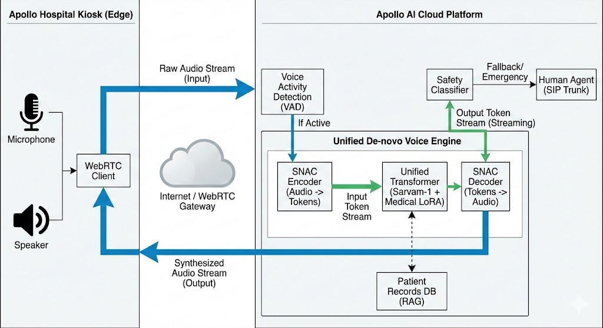

# Apollo Omni-Indic Voice Engine

A speech-to-speech voice assistant for Indian languages: **Hindi, Tamil, Telugu and Kannada** (plus English). It is designed for hospital kiosks and patient-assistance calls.

The core idea is a **single transformer that hears and speaks**. Audio is turned into discrete tokens with the [SNAC](https://github.com/hubertsiuzdak/snac) neural codec. The vocabulary of [Sarvam-1](https://huggingface.co/sarvamai/sarvam-1), an Indic 2B LLM, is extended with those 4,096 audio tokens, so one model can read and write speech the same way it handles text. A multilingual safety layer hands emergencies to a human.

> **Project status: research prototype.** All of the plumbing is implemented and tested: tokenization, vocabulary extension, speaker conditioning, the training loop, VAD, safety checks and the demo servers. A trained speech checkpoint is **not** part of this repository. Until you train one with `scripts/train_audio_llm.py`, the unified model produces arbitrary audio, and the demo servers use rule-based replies and Edge-TTS so they stay usable.



*The diagram shows the target system. RAG over patient records, medical LoRA and SIP transfer are not implemented yet; see [Roadmap](#roadmap).*

---

## Features

- **Unified audio LLM** (`apollo_voice_engine/models/audio_llm.py`)
  - Adds `<|audio_start|>`, `<|audio_end|>` and 4,096 SNAC tokens to Sarvam-1, placed *after* the text vocabulary so audio and text ids never collide.
  - Speaker-embedding prefix ("session anchor") keeps the voice consistent across a conversation.
  - Saved checkpoints reload without being extended a second time. 8-bit and 4-bit loading via bitsandbytes on CUDA.
- **SNAC tokenizer** (`models/snac_wrapper.py`): handles the 24 kHz codec's 1:2:4 codebooks, interleaved into 7 tokens per ~85 ms frame, and accepts `(T,)`, `(B, T)` or `(B, 1, T)` audio.
- **Three-phase training** (`training.py` + `scripts/train_audio_llm.py`): ASR (audio→text), TTS (text→audio) and audio→audio, all with a masked causal-LM loss.
- **Real-time helpers** (`inference/engine.py`)
  - WebRTC VAD at any sample rate, resampled internally. End-of-utterance detection fires once per utterance.
  - Streaming inference engine with latency metrics.
- **Multilingual safety classifier** (`safety/classifier.py`)
  - Emergency and caution keywords in 5 languages. English keywords match on word boundaries, so "icu" does not match "ridiculous".
  - Flags model responses that contain prescriptions, doses or diagnoses.
- **Cascaded baseline** (`speech_pipeline.py`): Whisper → Sarvam-1 → MMS-TTS (VITS).
- **Demo servers** (FastAPI and standard library), each with a responsive, accessible browser UI:

  | Script | What it shows | Heavy deps |
  |---|---|---|
  | `scripts/api_demo.py` | Text chat: safety routing + multilingual replies | none |
  | `scripts/speech_demo.py` | Mic → Whisper → policy → Edge-TTS | Whisper, ffmpeg, network for TTS |
  | `scripts/unified_demo.py` | Mic → SNAC → AudioLLM → SNAC, with Edge-TTS fallback | Sarvam-1 (~5 GB), SNAC |
  | `scripts/piper_tts_server.py` | Local Piper neural TTS | piper-tts + voices |
  | `apollo_voice_engine.integration.create_fastapi_app()` | Kiosk session/signalling API (WebSocket audio) | none |
  | `demo/index.html` | Static kiosk UI prototype (browser Web Speech API) | none |

## Tech stack

Python 3.10+ · PyTorch · Hugging Face Transformers / Accelerate · SNAC · WebRTC VAD · FastAPI + Uvicorn · OpenAI Whisper · Edge-TTS · Piper · pytest · Ruff

## Architecture

```
 audio in ─► VAD ─► SNACWrapper.encode ─► AudioLLM.generate ─► SNACWrapper.decode ─► audio out
                     (7 tokens / frame)    (Sarvam-1 + 4096 audio
                                            tokens + speaker prefix)
                                                  ▲
                          SpeakerEncoder ─────────┘  (session anchor)

 text / transcript ─► SafetyClassifier ─► DialoguePolicy ─► reply │ TRANSFER_TO_HUMAN
```

**Token layout** after `AudioLLM.load_model()`:

```
[0, audio_offset)                    text tokens + <|audio_start|> + <|audio_end|>
[audio_offset, audio_offset + 4096)  SNAC codes 0..4095
```

`audio_offset` is computed at load time from the tokenizer and embedding sizes, so it adapts to the base model. `SNACWrapper` also emits codes with a legacy `+50000` offset for standalone use; `AudioLLM.audio_tokens_to_ids` accepts either form.

**Training prompt formats** (`apollo_voice_engine/training.py`; masked positions are not supervised):

| Phase | Input (masked) | Target |
|---|---|---|
| `understanding` | `Transcribe … in {lang}:` `<as>` audio `<ae>` | text `</s>` |
| `generation` | `Synthesize … in {lang}: {text}` `<as>` | audio `<ae>` |
| `end2end` | `<as>` audio `<ae>` `<as>` | audio `<ae>` (self-reconstruction until paired dialogue audio is available) |

## Getting started

### Prerequisites

- Python 3.10 or newer
- `ffmpeg` on `PATH` for decoding microphone uploads in the speech demos
- A CUDA GPU is recommended for the unified model. CPU works for the tests and the lightweight demos.

### Install

```bash
git clone https://github.com/jeevithg090/Speech-to-Speech.git
cd Speech-to-Speech
python -m venv .venv && source .venv/bin/activate

# Core library + FastAPI demos + dev tools
pip install -e ".[server,dev]"

# Optional extras
pip install -e ".[speech]"        # Whisper + Edge-TTS
pip install -e ".[training]"      # librosa, soundfile, tqdm
pip install -e ".[quantization]"  # bitsandbytes (CUDA)
pip install -r requirements-piper.txt
# or everything at once:
pip install -r requirements.txt
```

### Configure

Copy `.env.example` to `.env`. Every variable is optional, and `.env` is loaded automatically when `python-dotenv` is installed (it comes with the `server` extra).

| Variable | Default | Purpose |
|---|---|---|
| `APOLLO_HOST` | `127.0.0.1` | Interface the demo servers bind to (`0.0.0.0` to expose) |
| `APOLLO_PORT` | per script (8000 / 6969 / 8085) | Port override |
| `APOLLO_CORS_ORIGINS` | `*` | Comma-separated allowed origins |
| `APOLLO_MAX_UPLOAD_MB` | `10` | Max audio upload size |
| `APOLLO_MAX_TEXT_CHARS` | `2000` | Max text query length |
| `APOLLO_WHISPER_MODEL` | `small` | Whisper size for `speech_demo.py` |
| `HF_TOKEN` | – | Hugging Face token, only needed for gated models |
| `PIPER_VOICE_DIR` | `~/.local/share/piper_voices` | Where Piper `.onnx` voices live |
| `NGROK_AUTH_TOKEN` | – | Used by the Colab notebooks to expose a demo |

### Run

```bash
# Instant, no models: text chat + safety routing
python scripts/api_demo.py                 # http://127.0.0.1:8000  (API docs at /docs)

# Whisper + Edge-TTS voice demo
APOLLO_PORT=8001 python scripts/speech_demo.py

# Unified SNAC + AudioLLM demo (downloads models on first run; poll /api/health)
python scripts/download_models.py          # optional pre-fetch
python scripts/unified_demo.py             # http://127.0.0.1:6969

# Piper TTS
python -m piper.download_voices en_US-lessac-medium
python scripts/piper_tts_server.py --open  # http://127.0.0.1:8085

# CLI tools
python scripts/demo.py --check-only
python scripts/demo.py --input question.wav --output reply.wav --model checkpoints/your-model
python scripts/unified_cli.py --dataset indic_voices_dataset --language ta
```

Example API call:

```bash
curl -s -X POST http://127.0.0.1:8000/api/chat \
  -H 'Content-Type: application/json' \
  -d '{"text": "मुझे छाती में दर्द हो रहा है", "language": "hi"}'
# {"response": "आपातकाल का पता चला। ...", "action": "TRANSFER_TO_HUMAN", "safety_level": "emergency", ...}
```

### Train

`indic_voices_dataset/metadata.json` lists 2,000 utterances (500 each for hi/ta/te/kn) from IndicVoices. The audio files are **not** committed; download them into `indic_voices_dataset/dataset_audio/` so they match the `audio_path` entries.

```bash
pip install -e ".[training]"
python scripts/train_audio_llm.py --phase understanding --epochs 5
python scripts/train_audio_llm.py --phase all --epochs 10 --batch-size 2 --checkpoint-dir checkpoints
```

The `notebooks/` folder holds the Colab notebooks used for experiments: training, optimisation, safety, API demo via ngrok and so on.

## Testing and quality

```bash
pytest            # 190+ tests, run fully offline in ~15 s on CPU
ruff check .      # lint
ruff format .     # format
```

The tests run without downloading anything. SNAC is used with **randomly initialised weights of the real 24 kHz architecture**, and Sarvam-1 is replaced by a tiny Llama checkpoint built on the fly. This covers the real encode/decode, vocabulary extension, generation, training-loop and HTTP code paths. Network services such as Whisper weights and Edge-TTS are stubbed. Tests that need `ffmpeg` are skipped if it is not installed.

## Deployment

The demo servers are plain ASGI apps:

```bash
APOLLO_HOST=0.0.0.0 APOLLO_CORS_ORIGINS=https://kiosk.example.org \
  uvicorn scripts.api_demo:app --host 0.0.0.0 --port 8000 --workers 2
```

Notes for production use:

- Keep `APOLLO_CORS_ORIGINS` restricted and put the servers behind TLS. The microphone APIs in the browser require HTTPS outside `localhost`.
- `unified_demo.py` holds the models in process memory, so run **one worker per GPU**.
- Pre-download models (`scripts/download_models.py`) and set `HF_HUB_OFFLINE=1` in the runtime image.
- Edge-TTS is a Microsoft network service. For air-gapped kiosks, use Piper or MMS-TTS (`speech_pipeline.py`).

## Project structure

```
apollo_voice_engine/
├── __init__.py            # version, load_config()
├── config/model_config.yaml   # reference model/training/inference settings
├── models/
│   ├── audio_llm.py       # Sarvam-1 + audio vocabulary, speaker prefix, generation
│   ├── snac_wrapper.py    # SNAC encode/decode, 7-token frame interleaving
│   └── speaker_encoder.py # speaker-embedding interface (deterministic mock)
├── inference/engine.py    # VAD, InferenceEngine, StreamingSession
├── safety/classifier.py   # multilingual emergency/caution/unsafe-advice detection
├── integration/webrtc_server.py  # kiosk sessions + FastAPI/WebSocket app
├── training.py            # training-example construction & collation
├── speech_pipeline.py     # cascaded Whisper → LLM → MMS-TTS baseline
├── dialogue.py            # rule-based multilingual dialogue policy
├── audio_io.py            # ffmpeg decoding, WAV encoding
├── metrics.py             # thread-safe running metrics
└── settings.py            # APOLLO_* environment settings
scripts/                   # demo servers, CLI demo, training, model download
demo/                      # browser UIs served by the scripts (+ static kiosk prototype)
indic_voices_dataset/      # dataset metadata (audio not committed)
notebooks/                 # Colab experiments and architecture diagram
tests/                     # pytest suite
```

## Roadmap

- Train and publish a speech-capable checkpoint, starting with the `understanding` and `generation` phases.
- Replace the mock `SpeakerEncoder` with a real one (ECAPA-TDNN / WavLM) and train `speaker_proj`.
- Wire a text head (or interleaved text/audio output) so the unified path can run the safety classifier on responses.
- Real WebRTC peer connections (aiortc) and SIP transfer in `integration/` (currently stubs).
- RAG over appointment/pharmacy data in place of the canned demo replies.

## License

No license file is included yet; the package metadata marks the project as proprietary. Add a `LICENSE` before reusing or distributing the code.
